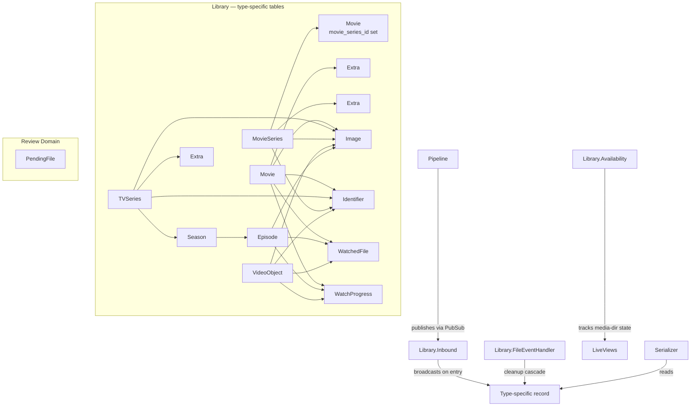
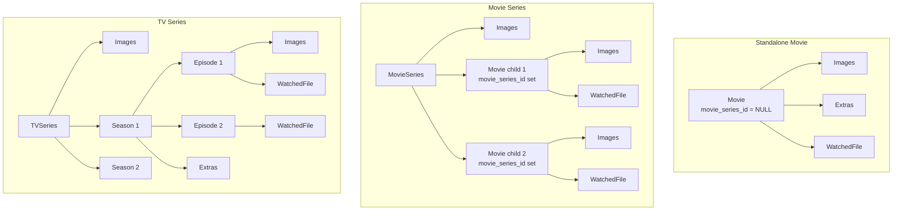

# Library

The library is the core data domain. It stores all media entities, their relationships, watch progress, and file tracking. Built on [Ecto](https://github.com/elixir-ecto/ecto) with SQLite, organized as type-specific schemas (Movie, TVSeries, MovieSeries, VideoObject) wrapped by the `MediaCentaur.Library` context module.

> [Architecture](architecture.md) · [Watcher](watcher.md) · [Pipeline](pipeline.md) · [TMDB](tmdb.md) · [Playback](playback.md) · **Library** · [Input System](input-system.md)

- [Architecture](#architecture)
- [Key Concepts](#key-concepts)
- [Entity Hierarchy](#entity-hierarchy)
- [Resources](#resources)
- [Inbound API](#inbound-api)
- [File Tracking](#file-tracking)
- [Availability](#availability)
- [Deletion](#deletion)
- [Review Domain](#review-domain)
- [Module Reference](#module-reference)

## Architecture

The library uses **type-specific tables** instead of a single polymorphic Entity table. Each media type is its own first-class Ecto schema (Movie, TVSeries, MovieSeries, VideoObject) with its own table, associations, and UUID identity. Images, identifiers, extras, and watch progress hang off the type-specific record via type-specific FKs (`movie_id`, `tv_series_id`, `movie_series_id`, `video_object_id`).

## Key Concepts

**Entity tables:**

| Type | Table | Schema | Children |
|------|-------|--------|----------|
| Movie | `library_movies` (`movie_series_id` NULL = standalone) | `Library.Movie` | Extras |
| TV Series | `library_tv_series` | `Library.TVSeries` | Seasons → Episodes, Extras |
| Movie Series | `library_movie_series` | `Library.MovieSeries` | Movies (children), Extras |
| Video Object | `library_video_objects` | `Library.VideoObject` | — |

The `Movie` schema serves both standalone movies and MovieSeries children. The `movie_series_id` column distinguishes them.

> The old `library_entities` table was dropped on 2026-04-03 (migration `20260403000002_drop_entity_table.exs`). Type-specific tables are the only data path. `library_entity_id` columns survive in unrelated tables (release_tracking, etc.) as references to type-specific UUIDs that were preserved across the data migration — legacy-named columns, correct values.

**One image per role per owner.** Roles: `poster`, `backdrop`, `logo`, `thumb`. Enforced by per-owner-type unique indexes on `(<owner_id>, role)`.

**External identifiers.** The `ExternalId` resource links each type record to TMDB IDs (and potentially IMDB, TVDB in the future). Stored as `{source, external_id}` per row.

**File tracking.** `WatchedFile` links a video file path to a `PlayableItem` (`playable_item_id`), never to the type record directly. Presence on disk is `FilePresence`'s (ADR-045): a row per path the watcher has seen, swept by `Library.AbsenceSweeper` after `file_absence_ttl_days`.

## Entity Hierarchy

## Resources

### Movie / TVSeries / MovieSeries / VideoObject

The four top-level type records. Each carries common attributes — `name`, `description`, `date_published`, `genres`, `duration`, `director`, `content_rating` — plus type-specific fields (e.g. `number_of_seasons` on `TVSeries`, `position` on a Movie linked to a MovieSeries, `content_url` on Movie / Episode / VideoObject for the playable file path). The Ecto schemas in `lib/media_centaur/library/` are the canonical reference.

CRUD goes through `MediaCentaur.Library` (the context facade) using ordinary Ecto queries — no Ash actions or polymorphic dispatch. Reads that need full association trees use the dedicated helper modules listed in the [Module Reference](#module-reference).

### Season

TV season. One per entity per season number.

**Key attributes:** `season_number`, `number_of_episodes`, `name`

### Episode

TV episode within a season. `content_url` is virtual — materialised from the
WatchedFile chain at read time. `cast_person_ids` is the episode's cast
membership (season regulars + guest stars) as TMDB person ids referencing the
parent series' aggregate-cast embeds.

**Key attributes:** `episode_number`, `name`, `description`, `duration_seconds`, `date_published`, `cast_person_ids`

### Movie (child)

Movie within a movie series. Stores per-movie `content_url` and `position` in the series.

**Key attributes:** `name`, `description`, `date_published`, `duration`, `director`, `content_url`, `tmdb_id`, `position`

### Extra

Bonus feature (featurette, behind-the-scenes, deleted scene). Belongs to entity or season.

**Key attributes:** `name`, `content_url`, `position`

### Image

Artwork file. One per role per owner (entity, movie, or episode).

**Key attributes:** `role`, `url` (TMDB source), `content_url` (local relative path), `extension`

**Roles:** `poster`, `backdrop`, `logo`, `thumb`

### ExternalId

External service id for any owner. Stored in `library_external_ids` with the polymorphic `(owner_type, owner_id)` pair — there are no per-type FK columns. `Library.ExternalIds` is the API (`put/3`, `find_by_external_id/2`).

**Key attributes:** `source` (`"tmdb"`, `"tmdb_collection"`, `"imdb"`), `external_id`, `owner_type`, `owner_id`

### PlayableItem

The playable leaf's identity: one row per movie / episode / video object, `(container_type, container_id)` naming the owner, `position` its ordinal. Files and progress hang off it, so a leaf's files and watch state survive the owner being re-shaped. `Library.PlayableItems` is the API.

### WatchedFile

Links a video file on disk to its `PlayableItem`. `Library.Files` is the API.

**Key attributes:** `file_path`, `media_dir`, `playable_item_id`, `file_presence_id`

### FilePresence

The scan's ledger of every path the watcher has seen under a media directory, and the seat of "is this file on disk". `WatchedFile` and `ExtraFile` reference it by a plain column. The watcher stamps it on detection; `Library.AbsenceSweeper` purges rows absent past `file_absence_ttl_days` (drives confirmed available only) through `Library.Deletion`.

### WatchProgress

One profile's progress on one playable item, unique on `(profile_id, playable_item_id)` (ADR-078). Written by `Library.Progress` (in-memory hot state keyed `{profile_id, playable_item_id}`, flushed to rows by `Library.Progress.Worker`); read through `Library.Progress.get/2`.

**Key attributes:** `position_seconds`, `duration_seconds`, `completed`, `last_watched_at`, `profile_id`, `playable_item_id`

The row holds two independent facts (see [Watch state](#watch-state)): the watched mark (`completed`) and the viewing in flight (`position_seconds`, `duration_seconds`, `last_watched_at`). `ExtraProgress` has the same shape and the same writer rules, keyed by `(profile_id, extra_id)`; both implement `Library.ProgressTracker`.

### SeriesWatchPosition

Where one profile is in one series — a TV series or a movie collection: the order key of the last item playback finished there, and when. Table `library_series_watch_positions`, unique on `(profile_id, series_id)`. It stores the item's order key, not its id, so it survives the item's deletion. `Library.SeriesWatchPositions` reads and writes it and is used only inside `Library`.

**Key attributes:** `profile_id`, `series_type` (`:tv_series`, `:movie_series`), `series_id`, `order_key`, `finished_at`

Every watching row is a profile's: `WatchProgress`, `ExtraProgress` (unique on `(profile_id, extra_id)`) and `PlaybackOverride` (unique on `(profile_id, owner_type, owner_id)`) carry `profile_id` as a plain column — no `belongs_to`, so `Library` takes no dependency on `Profiles`. They are read only through `Library.ProgressRecords` (`list_for_container/3`, `fetch_for_container/3`, `fetch_for_extra/2`) and `Library.PlaybackOverrides` (`get/3`, `upsert/4`, `clear/3`), the profile id always first. No type record carries a `has_one :watch_progress` association: with a profile the cardinality is one-to-many, so a title's progress is loaded by `(profile_id, type, id)` and never preloaded. Removing a profile takes its rows with it by `ON DELETE CASCADE`; `EntityCascade` deletes them when their title goes. `SeriesWatchPosition` follows the same two rules: its `profile_id` cascades, and `EntityCascade` deletes a series' positions with the series (`series_id` has no foreign key, since a series is one of two tables).

## Watch state

Where a profile is in a title is one derived value, `Library.TitleProgress`, computed from three stored facts. The moduledocs hold the contract; this section is the map.

| Fact | Stored on | Written by |
|---|---|---|
| Series watch position | `SeriesWatchPosition` | Playback finishing an item of the series (`ProgressRecords.finish/3`). Nothing else. |
| Viewing in flight | The item progress row: `position_seconds`, `duration_seconds`, `last_watched_at` | Position ticks. Ended (offset 0) by a finish and by either watched control. |
| Watched mark | The item progress row: `completed` | Set by a finish or Mark watched; cleared by Mark unwatched. |

**Terms.** The **ordered set** is a title's playable items that have a file, in story order (`EpisodeOrder.ordered_items/1`, `MovieOrder.ordered_items/1`; a movie or standalone video is a set of one). An item's **order key** is where it sits in that order, independent of its record: padded season and episode numbers for an episode, release date and collection position for a collection movie. Order keys are lists of strings compared in Elixir, never in SQL. A viewing **counts** from an offset of 60 seconds (`ProgressRecords.viewing?/1`); a shorter one changes nothing.

**Writers.**

- A position tick writes the viewing only. The in-memory row (`Library.Progress`) carries no watched mark, and the flush never writes one, so starting a watched item again keeps its mark.
- A finish (`Library.Progress.complete/2` → `ProgressRecords.finish/3`) sets the mark, sets the offset to 0, and for an item of a series moves the series watch position to it, in one transaction. It then publishes `{:entity_watch_completed, record, actor}` on `library:watch_completed`, every time: finishing an item again is a second completion and a second watch-history event.
- Mark watched sets the mark and ends the viewing, in memory too (`Library.Progress.clear_viewing/2`). Mark unwatched clears the mark and ends the viewing. Neither stamps `last_watched_at` and neither moves the series watch position. Mark watched publishes the completion event when the item was not marked before.
- The control an item offers is `ProgressRecords.watched_control/1`: Mark watched while the item is unmarked or has a viewing that counts, else Mark unwatched. `toggle_watched/3` and `toggle_extra_watched/3` apply the control the page shows.

**The rule** (`Library.TitleProgress`, pure):

1. A viewing that counts and is newer than the series watch position (or there is no position) is resumed; with several, the newest.
2. Otherwise, with a position, next is the first item of the ordered set whose order key is after it. If there is none, the title is complete.
3. Otherwise next is the first item with no watched mark. If every item is marked, the title is complete.

The state is `:complete` when there is no next, `:unstarted` when there is no position, no mark and no viewing that counts, else `:in_progress`. `TitleProgress.percent/1` is the measure every bar shows: `(before_next + offset / duration of next) / total`, 100 when complete.

**Readers.** `ProgressRecords.title_progress/2` assembles one title's progress from an entity view (playback resolution, the progress broadcast, the detail view models). `title_progresses/2` and `title_progresses_by_kind/2` are the bulk reads for callers holding ids (the library grid, Continue Watching). Both read the rows at the live offset of a session in flight (`Library.Progress.overlay_in_memory/1`). No caller outside `Library` reads a series watch position.

**Continue Watching** (`Library.HomeFeed.list_in_progress/2`) lists a TV series while its title progress is `:in_progress`, and a movie or standalone video while its row has a viewing that counts. A collection is never an entry; its member movies are (UIDR-025). A series whose only activity is hand marks has no time and sorts last.

**What follows from the rule:**

- A rewatch continues from the last item finished, whatever the watched marks say, and the series is in progress until its final item is finished.
- Finishing an earlier item again moves Play to the item after it.
- A skipped item is not returned to. The series is complete when the position reaches the final item; the skipped item stays unmarked.
- Watched marks decide Play only in a series where playback has finished nothing.
- Deleting a finished item does not move the position. The measure counts items in the ordered set, so with finished items deleted the bar reads near the start of what remains.
- A viewing left from an earlier pass is not resumed ahead of the position, but when Play reaches that item it starts at that offset.
- A series abandoned midway stays on Continue Watching until more recently watched titles fill the row.

Two neighbouring facts are read from watched marks and are not title progress: the furthest episode seen (`ProgressRecords.last_watched_episode/2`, which the Watchlist reads when a series is followed) and the per-season watched counts on the detail page. `WatchHistory` logs completions and is not the source of the position; its moduledoc says why.

The table was filled for existing installs by the data migration `priv/repo/data_migrations/20261114100100_series_watch_positions.exs`, whose moduledoc states how each profile's position was read from its rows.

> Settings (the per-installation key/value store) is its own bounded context — `MediaCentaur.Settings.Entry` — not part of `Library`. See [`architecture.md`](architecture.md#bounded-contexts).

## Inbound API

`MediaCentaur.Library.Inbound` is the pipeline's entry point into the library. It is a PubSub-listener GenServer (subscribed to `pipeline:publish`) that handles `{:entity_published, event}` messages and:

1. **Resolves** existing type records by TMDB id via `Library.ExternalIds.find_by_external_id/2`
2. **Creates** new records (and their children) if not found, with race-loss recovery on the unique `(source, external_id)` constraint
3. **Links** to existing records if found — adds new seasons, episodes, MovieSeries children, extras
4. **Moves** staged images from the staging directory to the final `images_dir/<record_id>/role.ext`

The pipeline never calls `Library.Inbound` directly; everything flows through PubSub.

## File Tracking

`Library.FileEventHandler` (GenServer) subscribes to PubSub for file-removal events and hands each batch to `Library.Deletion.cleanup_removed_files/1`:

**Immediate cleanup** (file deleted):
1. Delete WatchedFile records
2. Delete child records (episodes, movies, extras) matching removed paths
3. Delete empty seasons
4. Delete orphaned top-level records (no remaining WatchedFiles)
5. Delete cached image files

**Deferred cleanup** (file gone from an *available* drive):
1. The `FilePresence` row stays, marked absent by the watcher's health check
2. `Library.AbsenceSweeper` ticks daily and purges rows absent longer than `file_absence_ttl_days` — only for drives confirmed available, so an unmounted drive never loses its library
3. Each purge runs `Library.Deletion.cleanup_removed_files/1`, the same cascade as an immediate deletion

## Availability

`Library.Availability` is a top-level GenServer that tracks per-media-directory mount/reachability state. It exposes `available?/1` so UI code (and the LiveView templates that drive cards and the detail panel) can replace the **Play** button with a muted **Offline** indicator when a file's underlying drive is unmounted or unreachable.

This is the v0.20.0 fix for the silent-failure mode where pressing Play on an unmounted file did nothing.

## Deletion

`Library.Deletion` provides UI-initiated file and folder deletion (`delete_file/1`, `delete_files/1`, `delete_folder/2`) from the detail modal's info page and from Review.

**Per-file deletion:**
1. `File.rm(path)` — `:enoent` (already absent) treated as success
2. `Deletion.cleanup_removed_files([path])` — removes WatchedFile, child records (episode/movie/extra matched by `content_url`), cascades record deletion if orphaned
3. Broadcasts `{:entities_changed, entity_ids}`

**Folder deletion:**
1. Pre-collect all WatchedFile paths under the folder (prefix match) — critical because `rm -rf` does not generate per-file inotify events
2. `File.rm_rf(folder_path)` — removes entire directory tree
3. `Deletion.cleanup_removed_files(collected_paths)` — explicit cleanup with pre-collected paths
4. Broadcasts `{:entities_changed, entity_ids}`

**Cascade deletion:** When the last file for a top-level record is removed, `EntityCascade.destroy!/1` runs the FK-safe deletion order: watch progress and series watch positions → extras → episodes → seasons → movies → images → image directories → identifiers → top-level record.

**Watcher race condition:** `cleanup_removed_files/1` is idempotent — if the watcher also detects the deletion (for single-file deletes via inotify), it calls the same function. The second cleanup finds no WatchedFile records and returns `[]` (no-op). The watcher's 3-second debounce means the UI's explicit cleanup always completes first.

**Playback guard:** Deletion is blocked if the entity has an active playback session. The UI shows an error flash instead of the confirmation dialog.

## Review Domain

Separate bounded context (`MediaCentaur.Review`) for files awaiting human review.

**PendingFile** stores: file path, parsed metadata, best TMDB match with confidence, all scored candidates, status (`:pending` / `:approved` / `:dismissed`).

**Review.Intake** maps pipeline payloads into PendingFile records.

See [pipeline.md](pipeline.md#review-flow) for the full review workflow.

## Module Reference

| Module | Description | Path |
|--------|-------------|------|
| `MediaCentaur.Library` | Library context — CRUD for all types | `lib/media_centaur/library.ex` |
| `MediaCentaur.Library.Movie` | Standalone or collection movie | `lib/media_centaur/library/movie.ex` |
| `MediaCentaur.Library.TVSeries` | TV series with seasons/episodes | `lib/media_centaur/library/tv_series.ex` |
| `MediaCentaur.Library.MovieSeries` | Movie collection/saga | `lib/media_centaur/library/movie_series.ex` |
| `MediaCentaur.Library.VideoObject` | Standalone video | `lib/media_centaur/library/video_object.ex` |
| `MediaCentaur.Library.Season` | TV season | `lib/media_centaur/library/season.ex` |
| `MediaCentaur.Library.Episode` | TV episode | `lib/media_centaur/library/episode.ex` |
| `MediaCentaur.Library.Extra` | Bonus feature | `lib/media_centaur/library/extra.ex` |
| `MediaCentaur.Library.Image` | Artwork | `lib/media_centaur/library/image.ex` |
| `MediaCentaur.Library.ExternalId` | External id (TMDB, IMDB) — schema for `library_external_ids`; `Library.ExternalIds` is the API | `lib/media_centaur/library/external_id.ex` |
| `MediaCentaur.Library.PlayableItem` | Playable-leaf identity; `Library.PlayableItems` is the API | `lib/media_centaur/library/playable_item.ex` |
| `MediaCentaur.Library.FilePresence` | Scan ledger + on-disk presence | `lib/media_centaur/library/file_presence.ex` |
| `MediaCentaur.Library.Files` | WatchedFile / ExtraFile rows and the file → top-level entity walk | `lib/media_centaur/library/files.ex` |
| `MediaCentaur.Library.ImageCache` | Where artwork files live on disk (per-media-dir cache, staging, path resolution) | `lib/media_centaur/library/image_cache.ex` |
| `MediaCentaur.Library.Views.*` | ETS read projections (Browse, Detail, ContinueWatching, …; ADR-041) | `lib/media_centaur/library/views/` |
| `MediaCentaur.Library.WatchedFile` | File → PlayableItem link | `lib/media_centaur/library/watched_file.ex` |
| `MediaCentaur.Library.WatchProgress` | One profile's progress on one PlayableItem: the watched mark and the viewing in flight | `lib/media_centaur/library/watch_progress.ex` |
| `MediaCentaur.Library.SeriesWatchPosition` | One profile's place in one series: the order key of the last item playback finished | `lib/media_centaur/library/series_watch_position.ex` |
| `MediaCentaur.Library.TitleProgress` | Where a profile stands in a title: state, next item, measure (derived, never stored) | `lib/media_centaur/library/title_progress.ex` |
| `MediaCentaur.Library.ProgressRecords` | Persisted watch state: the finish, the watched controls, and the reads of title progress | `lib/media_centaur/library/progress_records.ex` |
| `MediaCentaur.Library.Progress` | In-memory viewing in flight per `{profile_id, playable_item_id}`, flushed by `Progress.Worker`; the finish | `lib/media_centaur/library/progress.ex` |
| `MediaCentaur.Library.TypeResolver` | UUID-to-type-record lookup | `lib/media_centaur/library/type_resolver.ex` |
| `MediaCentaur.Library.EntityShape` | Normalize type records to common map shape | `lib/media_centaur/library/entity_shape.ex` |
| `MediaCentaur.Library.EntityCascade` | Cascade-deletion order | `lib/media_centaur/library/entity_cascade.ex` |
| `MediaCentaur.Library.Inbound` | Pipeline → library inbound PubSub listener | `lib/media_centaur/library/inbound.ex` |
| `MediaCentaur.Library.Availability` | Per-media-dir mount/reachability tracker | `lib/media_centaur/library/availability.ex` |
| `MediaCentaur.Library.Browser` | Library browse + filter helpers used by LibraryLive | `lib/media_centaur/library/browser.ex` |
| `MediaCentaur.Library.ProgressTracker` | Shared changesets of the item progress schemas (tick, finish, the watched controls) | `lib/media_centaur/library/progress_tracker.ex` |
| `MediaCentaur.Library.LastActivity` | "Recently watched" / activity ordering helper | `lib/media_centaur/library/last_activity.ex` |
| `MediaCentaur.Library.Helpers` | PubSub broadcast helpers | `lib/media_centaur/library/helpers.ex` |
| `MediaCentaur.Library.FileEventHandler` | Reacts to file-removal events | `lib/media_centaur/library/file_event_handler.ex` |
| `MediaCentaur.Library.Deletion` | Disk deletes + record-cleanup cascade | `lib/media_centaur/library/deletion.ex` |
| `MediaCentaur.Library.ChangeLog` | Library change recording | `lib/media_centaur/library/change_log.ex` |
| `MediaCentaur.Review` | Review context | `lib/media_centaur/review.ex` |
| `MediaCentaur.Review.PendingFile` | Pending review file | `lib/media_centaur/review/pending_file.ex` |
| `MediaCentaur.Review.Intake` | `review:intake` reactor → `Review.add_pending_file/1` etc. | `lib/media_centaur/review/intake.ex` |
