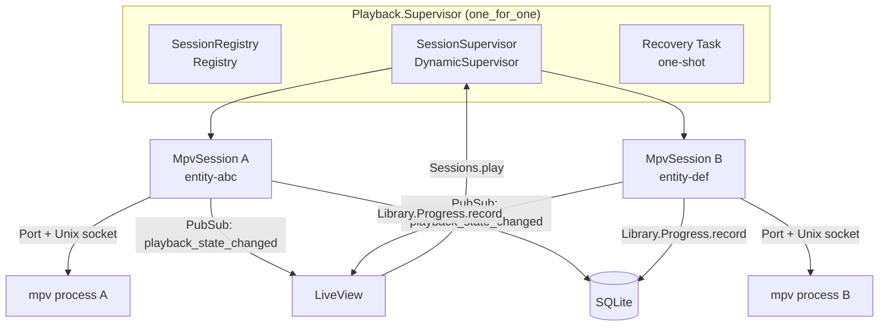
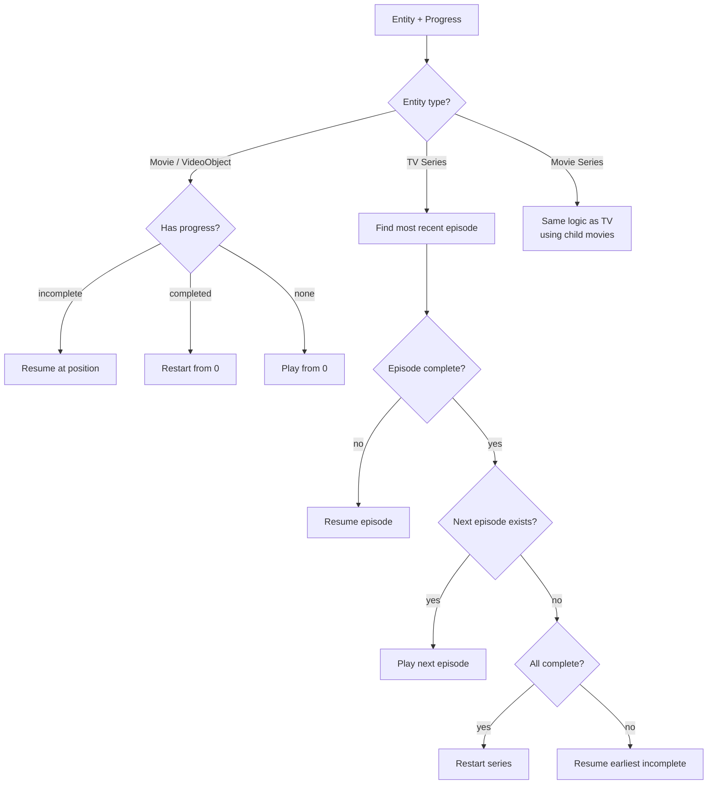

# Playback

End-user playback documentation has moved to the wiki:

- **[Playback](https://github.com/media-centaur/media-centaur/wiki/Playback)** — starting playback, resume logic, next-episode, multi-session.
- **[Keyboard & Gamepad](https://github.com/media-centaur/media-centaur/wiki/Keyboard-and-Gamepad)** — full input reference, including mpv controls.

---

## Contributor internals

The remainder of this file documents the Playback subsystem's internal architecture — MpvSession, session supervision, MPV IPC protocol, WatchingTracker, session recovery (ADR-023). This is developer-only content; end users should use the wiki links above.

### Architecture



### Key Concepts

**Multi-session playback:** Multiple mpv processes can run concurrently, one per entity. Each session is identified by its entity_id and uses an entity-scoped socket (`media-centaur-{entity_id}.sock`).

**Episode auto-advance ([ADR-062](../decisions/architecture/2026-08-18-062-playlist-based-episode-advance.md)):** a TV episode session is a *viewing chain*, not one file. The backend appends the successor episode to the mpv playlist (`Playback.NextEpisode`), so end-of-episode rolls into the next file inside the same mpv process — no window teardown, no HDR re-lock. The queueing decision runs off mpv's own `playlist-count`/`playlist-pos` observations (append only while the current entry is the last — reconnect-safe by construction), and a `path` change is the advance signal: the session closes out the finished episode, replaces its entry with the file now playing (`Playback.Chain.advance/3`: the queued entry when the path matches, else re-identified from the host path), and queues the next successor. The successor is always the *literally next* episode — a story-order gap (undownloaded episode) ends the chain rather than being skipped. Gated by the `auto_play_next_episode` setting (default on), read at each queueing decision. The in-player "Next Episode" pill during credits (`next_episode.lua` in the bundled package, see [`mpv.md`](mpv.md)) is just `playlist-next`; the backend observes it like any other transition.

**Observation, not control:** The backend is a tracking system. The user controls mpv directly (keyboard, remote, gamepad). Each MpvSession observes position/duration/pause/eof via IPC, persists watch progress, and broadcasts state via PubSub.

**The session's shape:** `MpvSession` is a thin GenServer over pure modules, each testable without a process. It keeps the lifecycle only — open the transport, fold transport events, the reattach window, the three timers (reattach, capture debounce, the viewing stream's 1 Hz), finalise, terminate — and two values: the **entry** (`Playback.Entry`: what plays now — the file, its library identity, where it started; the one shape `Resolver`, `NextEpisode` and `SessionRecovery` build, replaced whole by an advance) and the **property mirror** (`Playback.MpvProperties`: what mpv last reported, one `apply/3` per `property-change`, the per-file reset, the `track-list` parser). `Playback.Chain` answers the queue test, the successor with its append command and the advance (ADR-062); `Playback.ProgressWriter` judges completion and runs the Library writes in tasks; `Playback.LanguageContext` is the track policy, a struct carrying the resolver's choice and the enforced `sid`, answering each `track-list` with the IPC to send and capturing a viewer's switch as an override. `Playback.Viewing` is built from the entry and the mirror. The session reacts to a property by name after the mirror holds it, and it is the one writer to the player: every module answers with commands, the session sends them.

**Players and transports ([ADR-080](../decisions/architecture/2026-10-22-080-one-playback-session-type-over-two-transports.md)):** a session plays on a **player**: `:host` (an mpv this computer spawns) or a paired remote player's id (the mpv inside the TV app, `campaigns/remote-players.md`). `Playback.Transport` is the seam: `Transport.Local` reaches the spawned process over its Unix socket with a host path; `Transport.Remote` reaches the device over its **player channel** (`Playback.Transport.Remote.Channel`, a WebSocket the device dials carrying mpv IPC JSON, handled by `MediaCentaurWeb.PlayerSocket`) with a media URL (`MediaCentaurWeb.Plugs.MediaServer`, a file by `FilePresence` id behind a capability token). The session keeps the host path as the identity of what plays and asks the transport for mpv's locator and for the identity of a reported path. Sessions are keyed by `{player, entity_id}`; every viewing event names its player. A dropped channel detaches the session for a 60 s window; a reconnecting player's channel reattaches it, and a host restart recovers it by asking the player what it plays (`Sessions.recover/1`: the transport finds the mpv, `SessionRecovery` resolves it). A removed player is not coming back: its channel hears `PlayerRemoved` on `players:updates`, tells the device's mpv `stop` and closes `:removed`, and the transport ends the viewing at once. The desktop's mpv autoloads the sidecar subtitles beside a local file; a remote mpv plays a URL, so `Transport.Remote` adds the file's sidecars (`Subtitles.sidecars_for_presence/1`) with `sub-add` once mpv has reported both the file's `path` and `file-loaded` (libmpv delivers them in either order), from `/media/:presence_id/subtitles/:basename` under the file's token. `quit` on a remote player is stop: the `end-file` it reports closes the viewing while the device's mpv lives on. A remote player's mpv lives for the app's life, so the transport sets nothing on it: the session options and the resume position ride on each `loadfile` as per-file options (`LaunchFlags.per_file_options/2`), the successor the session appends included (`Transport.queue/3`), led by the stream's own: FFmpeg's HTTP reconnect, so a host restart or a network blip stalls the stream and resumes it rather than ending the file early; mpv restores the instance at the file's end (ADR-080's 2026-10-22 amendment). `scripts/agents/mc-player-sim` stands in for a device with a desktop mpv.

**One viewing, one command door:** every reader sees a viewing as `Playback.Viewing` — the title words, position, pause, chapters and current chapter, tracks (bitmap subtitle tracks marked), the subtitle line and the **prompt** (Skip Intro, Next Episode, the countdown; `Viewing.prompt/1`, the same rules the bundled Lua draws from on the desktop, held equal by `chapter_words_lua_sync_test.exs`). It is `PlaybackStateChanged.now_playing` and the message on the per-player **viewing stream** (`Playback.subscribe_viewing/1`: `{:viewing, viewing}` on attach, on every discrete change and on position once a second, then `{:viewing_ended, event}`). A reader acts through `Playback.command/3` with a `Playback.Command` (`:toggle_pause`, `{:seek, seconds}`, `:activate_prompt`, `{:select_track, kind, id | :none}`); the session bounds it to the file (`Command.within/3`: a seek never crosses the end — mpv would otherwise sit paused on the last frame with no `eof-reached`) and renders it to IPC. A page's playing set — Continue Watching's pins, the card's playing dot, the detail's delete guard — is its own player's viewings (`LiveHelpers.load_playback_sessions/1`, `apply_playback_change/3`); Status is the one board over every player, keyed by player and title (`StatusHelpers.apply_session_change/2`). This is the remote player's OSD: its keys go to the host's page, which draws the viewing and sends the commands (`campaigns/remote-players.md`, M5). A transport that draws no subtitles (`Transport.draws_subtitles?/1`, the remote) never has a bitmap track enforced on it.

**Seek-aware progress tracking:** The `WatchingTracker` distinguishes continuous watching from seeking. Progress is only saved during continuous playback (10+ uninterrupted seconds). Jumps > 3 seconds reset the continuous timer.

**Completion trigger:** reaching the content end — where the credits begin (`Playback.Completion`). That is the start of a credits/outro chapter (a chapter titled "Credits"/"Outro" starting in the back 20% of the file) when the file has one; otherwise the duration less an assumed credits length of 10%, capped at 8 minutes for a movie and 3 minutes for anything else, so a long film is not marked watched before its final scene. Completion is monotonic — once marked complete, it never regresses. The session judges each persisted position itself (`MpvSession.judge_completion/1`) and keeps the set of items it completed; only the write runs in a task.

**Session end:** `finalize/1` broadcasts `PlaybackStateChanged :stopped` and then `SessionEnded` with that set. The title detail hosts read it to open a finished title with the finish prompt (UIDR-052): a movie, standalone or in a collection, or a show whose latest aired episode (TMDB's `last_episode_to_air`) the session completed. The web layer judges that, since Playback does not read TMDB (`TitleDetailHost.Finish`).

**Offline state:** `Library.Availability` tracks per-media-directory mount/reachability. When a file's media directory is unavailable, UI cards and the detail panel swap the **Play** button for a muted **Offline** indicator. The indicator clears automatically when availability restores — no LiveView reload needed.

**Error surfacing:** `Transport.Local.ExitClassifier.classify/1` tells a normal end (`{:ok, :ended}` — mpv reported a property event before exiting) from a startup failure (`{:error, :startup_failure, message}`, the message built from the exit status and mpv's last stderr lines). MpvSession attaches the classification to the flash message the UI shows, and pipes mpv's full stderr through `ProgressBroadcaster` into the console ring under the `:playback` component — readable on Status → Playback, or on `/console` — and the systemd journal for post-mortem inspection.

Because the production launch uses `--no-terminal` (which silences mpv's stderr entirely), the live port-data tail is usually empty. `MpvSession` adds `--log-file=<socket_dir>/media-centaur-<session_id>.log` to every spawn, and `Transport.Local.LogReader.fallback_tail/3` slurps the last 5 lines of that file when the port tail is empty — so the classifier always has the real mpv error string to summarise.

**Display-env resolution:** Before each spawn `DisplayEnv.resolve/1` builds the env list passed to `Port.open`. It prefers any `WAYLAND_DISPLAY` / `DISPLAY` already in the parent env, and falls back to scanning `$XDG_RUNTIME_DIR/wayland-N` (lowest N wins) and `/tmp/.X11-unix/XN` for live sockets. This protects against the common production failure where the systemd-user service started before the graphical session imported its env — without it, mpv aborts with status 1 and the classifier can only emit "mpv exited before playback started". When neither display server is reachable the session refuses to launch and broadcasts `PlaybackFailed{reason: :no_display}` so the UI can surface a clear message.

**Resume algorithm:** `Resume.resolve/2` determines what to play next:



### How It Works

#### Play Command

1. UI calls `Playback.play/2` with the socket's profile id and an entity UUID; the profile is captured here and held by the `MpvSession` for its life (ADR-078) — a switch mid-film does not re-home the progress
2. `Resolver.resolve/2` loads the entity and that profile's progress, runs `Resume.resolve/2`, and answers with the play params: the profile id and the `Playback.Entry` to play
3. `Sessions.play/2` checks the file and the Registry for duplicates, then starts a new `MpvSession` via `SessionSupervisor` with the params
4. MpvSession registers in `SessionRegistry` by `{player, entity_id}`, the entry's entity
5. `DisplayEnv.resolve/1` builds the env list (WAYLAND_DISPLAY / DISPLAY, resolved from parent env or socket discovery); on `{:error, :no_display}` the session broadcasts `PlaybackFailed{reason: :no_display}` and stops
6. MpvSession launches mpv with the flags `Playback.LaunchFlags` builds (IPC socket, log file, `--keep-open=yes`, `--resume-playback=no`, the bundled scripts package, the language policy, the per-file `--start` group, and `--script-opts-append=media_centaur_session-profile_id=<id>`, which pins the profile in the mpv process so recovery can read it back) plus the resolved display env; see [`mpv.md`](mpv.md) for the full table

#### MPV IPC Protocol

MpvSession communicates with mpv via newline-delimited JSON over a Unix domain socket:

**Commands sent:**
- `["observe_property", 1, "time-pos"]` — position tracking
- `["observe_property", 2, "duration"]` — total duration
- `["observe_property", 3, "pause"]` — pause state
- `["observe_property", 4, "eof-reached"]` — end of playlist (only fires at the final entry under `keep-open`)
- `["observe_property", 9, "playlist-count"]` / `[..., 10, "playlist-pos"]` — auto-advance queue check (ADR-062)
- `["observe_property", 11, "path"]` — playlist-advance detection
- `["observe_property", 12, "sub-text"]` / `[..., 13, "chapter"]` — the subtitle line and the current chapter, for the viewing a remote player's page draws
- `Transport.queue/3` — queue the successor episode: `["loadfile", url, "append", -1, "start=N"]` on the host (per-entry start; the index argument needs mpv ≥ 0.38), the same with the session options as per-file options on a remote player
- the reader's commands (`Playback.Command`): `["cycle", "pause"]`, `["seek", n, "relative"]`, `["seek", t, "absolute"]` / `["playlist-next"]` for the prompt, `["set_property", "aid" | "sid", id | "no"]`
- `["quit"]` — close player at playlist end

**Events received:**
- `property-change` for `time-pos`, `duration`, `pause`, `eof-reached`
- `end-file` with reason
- `shutdown`

#### Progress Persistence

| Event | Action |
|-------|--------|
| During active watching | Every position tick lands in memory via `Library.Progress.record/4`; `Library.Progress.Worker` flushes dirty rows every 5 s (`:library_progress_flush_interval_ms`) |
| On pause | Save immediately |
| On stop / EOF | Save immediately |
| During seeking | No save |

Each save goes through `Playback.ProgressWriter`: `judge/4` reads the tracker's `saveable_position` (guards against seek corruption) and, when `Completion.reason/4` (given the entry's kind of playable) says it completes the entry, adds `Entry.item/1` to the session's completed set; `persist/5` runs the write in a task — `Library.Progress.record/4`, then `LibraryProgress.complete/2` (monotonic) — and broadcasts the changed record. An unattributed entry (a file the library does not know) is observed and never written.

#### Progress Broadcasting

Every save broadcasts to `"playback:events"`:

```elixir
{:entity_progress_updated, %{
  entity_id: entity_id,
  profile_id: profile_id,
  summary: summary,
  resume_target: resume_target,
  changed_record: changed_record,
  last_activity_at: last_activity_at
}}
```

State changes broadcast with entity_id and profile_id:

```elixir
{:playback_state_changed, %{entity_id: entity_id, profile_id: profile_id, state: state, now_playing: now_playing, started_at: started_at}}
```

Once per session, right after `:stopped`:

```elixir
{:session_ended, %{entity_id: entity_id, profile_id: profile_id, completed: completed}}
```

`completed` is a `MapSet` of `{:movie | :video_object | :extra, id}` and `{:episode, id, season_number, episode_number}` — every item the session completed, empty when it ended before any. Episodes carry their numbers so a subscriber can compare them with TMDB's numbering without a read.

All three payloads are `Playback.Events` structs (map-match them; MC0012 pins the contract). Every event about watching state names the `profile_id` the session records under — `PlaybackFailed`, which fires before any state exists, is the one exception — so a page whose socket holds another profile can ignore it; the finish prompt opens only in the watcher's session.

#### Session Recovery (ADR-023)

One door, `Sessions.recover(player)`, and each transport finds its own orphaned mpvs (`Transport.recover/1`). For the host, a one-shot Task at boot calls it with `:host`: `Transport.Local` scans the socket directory for `media-centaur-*.sock` files, probes each mpv over its own line-framed connection, and removes the dead files. For a remote player, `Transport.Remote.Channel.connect/2` calls it with the player's id when the channel connects and no session holds the player: `Transport.Remote` asks the device's mpv over the channel and reads the presence row back out of the media URL it reports. Either way the transport hands `SessionRecovery.reattach_params/4` a property reader; it reads the position and `script-opts`, takes the profile id from the `media_centaur_session-profile_id` option `LaunchFlags` pinned at launch, resolves the entity, and the session starts through `Sessions.resume/2`, reattaching instead of loading. A running mpv whose `script-opts` carry no profile was started by the outgoing release: it is skipped with a log line rather than recovered under a guessed profile (mpv keeps playing; a host socket goes when it exits).

#### WatchingTracker

Pure function module that gates progress persistence:

| Position Delta | Behavior |
|----------------|----------|
| <= 3 seconds | Continuous playback, accumulate time |
| > 3 seconds | Seek detected, reset continuous timer |

After 10 continuous seconds, `actively_watching` becomes `true` and `saveable_position` starts advancing.

#### Display Helpers

**ProgressSummary** — computes display-ready progress for UI cards:
- Current episode (season, episode)
- Position and duration
- Episodes completed vs. total

**ResumeTarget** — computes button hints for what plays on click:
- Action: `begin`, `resume`
- Target entity/episode/movie identifiers
- Per-child targets for series grid items

### Module Reference

| Module | Description | Path |
|--------|-------------|------|
| `MediaCentaur.Playback.Sessions` | Public API facade (stateless): `play/2`, `resume/2`, `stop/2`, `list/0`, `get/2` by player | `lib/media_centaur/playback/sessions.ex` |
| `MediaCentaur.Playback.Transport` | The seam between the observer and an mpv: behaviour + dispatch | `lib/media_centaur/playback/transport.ex` |
| `MediaCentaur.Playback.Transport.Local` | The host player: spawn, Unix socket, exit classification | `lib/media_centaur/playback/transport/local.ex` |
| `MediaCentaur.Playback.Transport.Remote` | A paired player: the channel, media URLs, per-file options, reattach | `lib/media_centaur/playback/transport/remote.ex` |
| `MediaCentaur.Playback.Viewing` | One viewing as a reader sees it, with its prompt | `lib/media_centaur/playback/viewing.ex` |
| `MediaCentaur.Playback.Command` | What a reader may ask of a viewing, and the IPC each becomes | `lib/media_centaur/playback/command.ex` |
| `MediaCentaur.Playback.IntroChapter` | The Skip Intro chapter rule and target | `lib/media_centaur/playback/intro_chapter.ex` |
| `MediaCentaur.Playback.Transport.Remote.Channel` | The player channel's protocol over the socket handler's state | `lib/media_centaur/playback/transport/remote/channel.ex` |
| `MediaCentaur.Playback.Transport.Remote.PlayerRegistry` | Connected players and their media URLs | `lib/media_centaur/playback/transport/remote/player_registry.ex` |
| `MediaCentaur.Playback.SessionRegistry` | Registry wrapper, entity_id lookup | `lib/media_centaur/playback/session_registry.ex` |
| `MediaCentaur.Playback.MpvSession` | Per-session GenServer: the lifecycle, the timers, the entry and the mirror; the one writer to the player | `lib/media_centaur/playback/mpv_session.ex` |
| `MediaCentaur.Playback.Entry` | What a session plays now: the file, its library identity, where it started | `lib/media_centaur/playback/entry.ex` |
| `MediaCentaur.Playback.MpvProperties` | What mpv last reported: the mirror, its per-file reset, the `track-list` parser | `lib/media_centaur/playback/mpv_properties.ex` |
| `MediaCentaur.Playback.Chain` | The viewing chain: the queue test, the successor and its append, the advance (ADR-062) | `lib/media_centaur/playback/chain.ex` |
| `MediaCentaur.Playback.ProgressWriter` | Completion judged, progress written in tasks, the end-of-session refresh | `lib/media_centaur/playback/progress_writer.ex` |
| `MediaCentaur.Playback.LanguageContext` | The track policy: preferences loaded per entry, the resolver's choice and enforcement per `track-list`, override capture | `lib/media_centaur/playback/language_context.ex` |
| `MediaCentaur.Playback.SessionSupervisor` | DynamicSupervisor for sessions | `lib/media_centaur/playback/session_supervisor.ex` |
| `MediaCentaur.Playback.SessionRecovery` | The shared half of recovery: a property reader and a host path into the profile and the entry to reattach | `lib/media_centaur/playback/session_recovery.ex` |
| `MediaCentaur.Playback.Supervisor` | Groups Registry + SessionSupervisor + Recovery | `lib/media_centaur/playback/supervisor.ex` |
| `MediaCentaur.Playback.Resume` | Resume/next algorithm | `lib/media_centaur/playback/resume.ex` |
| `MediaCentaur.Playback.Completion` | When a viewing is complete: the credits chapter, or the duration less an assumed credits length | `lib/media_centaur/playback/completion.ex` |
| `MediaCentaur.Playback.Resolver` | UUID → play params (the profile and the entry) | `lib/media_centaur/playback/resolver.ex` |
| `MediaCentaur.Library.EpisodeList` | TV episode walking helpers | `lib/media_centaur/library/episode_list.ex` |
| `MediaCentaur.Playback.NextEpisode` | The successor's entry and a playing path's entry (ADR-062) | `lib/media_centaur/playback/next_episode.ex` |
| `MediaCentaur.Library.MovieList` | Movie series walking helpers | `lib/media_centaur/library/movie_list.ex` |
| `MediaCentaur.Playback.ProgressSummary` | Display-ready progress computation | `lib/media_centaur/playback/progress_summary.ex` |
| `MediaCentaur.Playback.ResumeTarget` | Play-button hint computation | `lib/media_centaur/playback/resume_target.ex` |
| `MediaCentaur.Playback.WatchingTracker` | Seek detection, continuous-watch gating | `lib/media_centaur/playback/watching_tracker.ex` |
| `MediaCentaur.Playback.Transport.Local.ExitClassifier` | Tells a normal end from a startup failure, with the message for the latter | `lib/media_centaur/playback/transport/local/exit_classifier.ex` |
| `MediaCentaur.Playback.Transport.Local.LogReader` | Tails the per-session `--log-file=` capture for the classifier | `lib/media_centaur/playback/transport/local/log_reader.ex` |
| `MediaCentaur.Playback.Transport.Local.IpcFraming` | Stitches the socket's raw chunks into IPC lines | `lib/media_centaur/playback/transport/local/ipc_framing.ex` |
| `MediaCentaur.Playback.Transport.Local.UserConfig` | The user's mpv config directory: stale copies of the bundled scripts | `lib/media_centaur/playback/transport/local/user_config.ex` |
| `MediaCentaur.Platform.DisplayEnv` | Resolves `WAYLAND_DISPLAY` / `DISPLAY` env for mpv spawn (OS-specific, so it lives under `Platform`) | `lib/media_centaur/platform/display_env.ex` |
| `MediaCentaur.Playback.ProgressBroadcaster` | Fan-out of progress + diagnostic output to PubSub and thinking logs | `lib/media_centaur/playback/progress_broadcaster.ex` |
